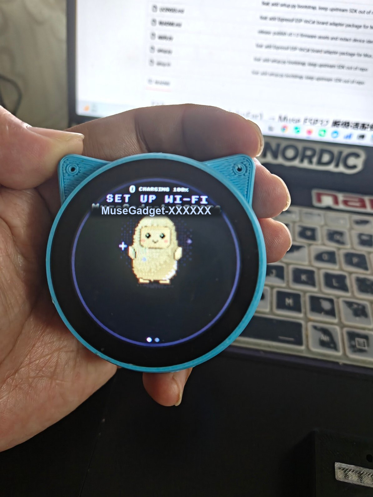
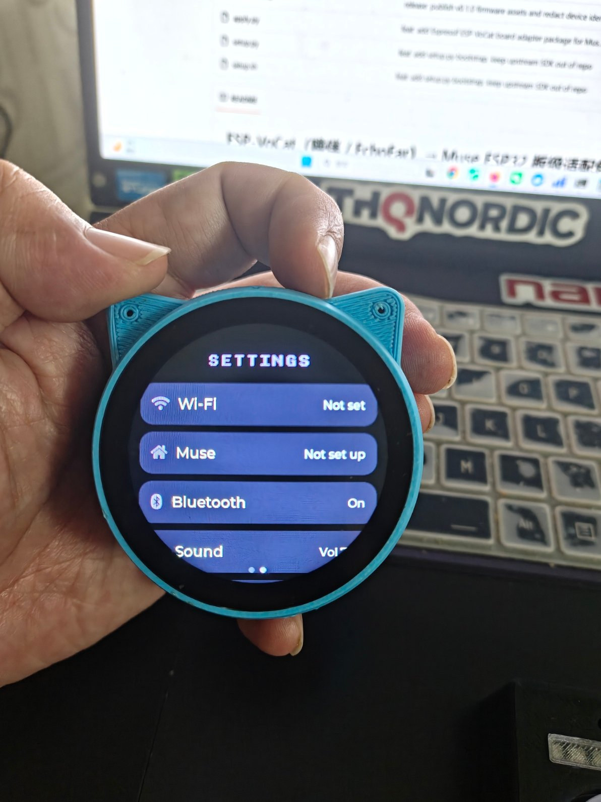
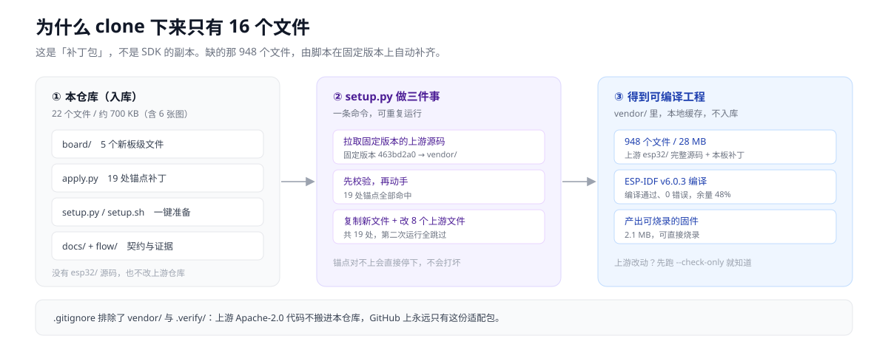
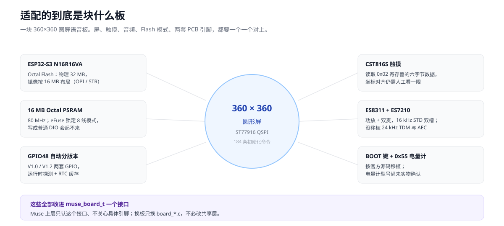
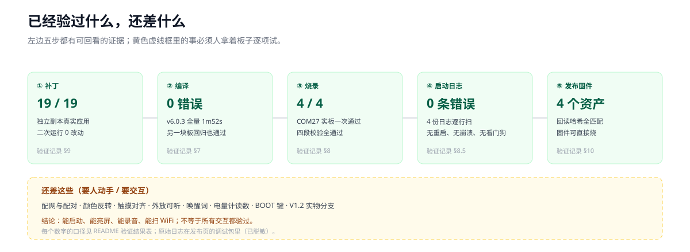

# 喵伴跑上 Muse：ESP-VoCat 板级适配包

   

## [👉 不想编译？直接下载固件，插上 USB 就能烧 ↗](https://github.com/fqyy360t/muse-esp-vocat/releases/tag/v0.1.0)

[](images/01-overview.svg)

**一句话**：把乐鑫「喵伴 / ESP-VoCat」这块圆屏语音板，接到 Muse Gadget 固件框架上。
这个仓库只有 22 个文件（含 6 张图）、约 700 KB，是一份板级补丁；官方 SDK 由脚本自动拉好，合进去就能编译。

[先看实拍](#先看实拍) · [从哪里开始读](#从哪里开始阅读) · [怎么跑](#怎么跑) · [验过什么](#验证结果) · [还差什么](#已知边界)

---

## 从哪里开始阅读

| 你现在想干什么 | 直接看这里 |
|---|---|
| 只想让板子亮起来 | [下载 v0.1.0 固件](https://github.com/fqyy360t/muse-esp-vocat/releases/tag/v0.1.0) → 压缩包里的烧录说明 → [常见问题](#常见问题) |
| 想自己编译、改代码 | [怎么跑](#怎么跑) → [板级说明](board/esp-vocat.md) → [迁移方案](docs/muse-sdk-迁移方案.md) |
| 想搞懂这块板的引脚 | [硬件接口定义](docs/esp-vocat-硬件接口定义.md) → [板级说明](board/esp-vocat.md) |
| 想确认到底验过没有 | [验证结果](#验证结果) → [构建验证记录](docs/构建验证记录.md) |
| 纳闷仓库为什么这么小 | [下面这张图](#这个仓库为什么这么小) → [迁移方案](docs/muse-sdk-迁移方案.md) |

## 先看实拍

<table>
<tr>
<td align="center" width="50%"><br><b>开机：配网引导页</b></td>
<td align="center" width="50%"><br><b>右滑：设置页</b></td>
</tr>
</table>

**2026-11-07 实拍**。左图是开机后的配网引导页（屏幕上那行英文意思是「设置无线网络」），
右图是右滑进设置页，无线网络、Muse、蓝牙都还没配好。
这两张说明圆屏、界面、触摸确实跑在喵伴上了；设备此刻停在上图，等着配网，还没连过网。

> 截图里的广播名属于设备标识，公开前已换成占位符，其余画面没动。界面文案本身是固件自带的英文，实拍保留原样。

## 这是什么问题

Muse Gadget SDK 有一套统一的板级接口，但它不认识喵伴：屏是 360×360 圆的，触摸和音频芯片的组合跟别的板不一样，
连闪存都是八线的。从零写要一口气搞定屏、触摸、双麦、电源和两套 PCB 引脚，任何一处对不上就是黑屏。

| 你会碰到的麻烦 | 这份补丁怎么处理 |
|---|---|
| 拉了 SDK，却不知道该改哪些文件 | 19 处锚点补丁一次合好，编译时只多链接一个板文件 |
| 板子分 V1.0 / V1.2 两套引脚，不知道手上哪版 | 上电靠 GPIO48 自动探测，结果存进掉电不丢的缓存 |
| 照常见教程配成普通四线闪存，烧完起不来 | 板级配置直接钉死八线闪存、OPI、16 MB 镜像 |

## 这个仓库为什么这么小

[](images/02-overlay.svg)

因为它是**补丁包**，不是 SDK 的副本：上游 `esp32/` 的 948 个文件由 `setup.py` 在固定版本 `463bd2a0` 上拉到 `vendor/`，
先校验再打补丁，而 `vendor/` 不入库。好处是上游 Apache-2.0 的代码不搬进本仓库、上游仓库零改动；
上游以后改了文件，`python setup.py --check-only` 会提前报锚点对不上，不会静默打坏。

## 这块板上有什么

[](images/03-board.svg)

图里六块都收进 `muse_board_t` 一个接口，Muse 上层不关心具体引脚，换板只换 `board_*.c`。

## 三个核心设计（以及没做什么）

1. **补丁包，不是分叉**：只带新增文件和 19 处锚点补丁。**没有**复制上游源码，也**没有**改过上游仓库。
2. **两套 PCB 自动分流**：GPIO48 探测 V1.0 / V1.2，先写锁存再切输出。**没有**在 V1.2 实物上验过，手上是 V1.0。
3. **八线闪存专用配置**：OPI / STR / 16 MB 镜像 / 16 MB 八线 PSRAM。**没有**支持普通四线闪存的板子。

## 怎么跑

**路线 A · 不编译**：下载发布页的固件压缩包，解压后照里面的说明烧四个文件：

```bash
esptool.py --chip esp32s3 --port COM27 --baud 921600 --after hard_reset \
  write_flash --flash_mode dout --flash_size keep --flash_freq 80m \
  0x0 bootloader.bin 0x10000 partition-table.bin 0x1d000 ota_data_initial.bin 0x20000 muse-gadget.bin
```

**路线 B · 自己编译**，三条命令，需要 ESP-IDF v6.0.3（本机 5.5.5 会因上游代码跨版本不兼容而失败）：

```bash
python setup.py
cd vendor/muse-gadget-sdk/esp32 && tools/muse/board.sh build vocat
tools/muse/board.sh flash vocat COM27
```

`ota_data_initial.bin` 不能省：不覆盖它，引导程序可能挑到空的第二个分区。

## 验证结果

[](images/04-verify.svg)

| 结果 | 口径（范围 / 分母） | 去哪看 |
|---|---|---|
| 19 / 19 处补丁命中 | 固定版本的独立副本上真实应用，第二次运行 0 处改动 | [验证记录 §9](docs/构建验证记录.md) |
| 编译 0 错误，分区余量 48% | ESP-IDF v6.0.3 容器全量编译一次，1 分 52 秒；另一块圆屏板回归同样通过 | [§7](docs/构建验证记录.md) |
| 4 / 4 个镜像校验通过 | COM27 实板一次烧录，硬复位后启动 | [§8](docs/构建验证记录.md) |
| 0 条错误级日志 | 4 份日志（烧录、12 秒启动、25 秒启动、运行态）逐行扫，无重启、崩溃、看门狗 | [§8.5](docs/构建验证记录.md) |
| 4 个发布资产回读一致 | 从发布页全部下载回来，哈希与本地原始文件逐字节一致 | [§10](docs/构建验证记录.md) |

这些数字只说明「能启动、能亮屏、能录音、能扫到无线网」，**不代表所有交互都验过**。

## 已知边界

- **只认这块原板**：烧到别的板（包括同款圆屏的 EchoEar-2ST）**会起不来**，引脚定义不同。
- **会覆盖原厂固件**：烧录不提供备份；想留 `xiaozhi 2.0.4.4`，得先自己把整片闪存读出来。
- **音频做了减法**：16 kHz 标准双槽，没移植官方的 24 kHz、四槽 TDM 和回声消除。
- **交互还没逐项验**：配网与配对、颜色、触摸对齐、外放、唤醒词、电量计、BOOT 键。设备现在停在等配网，且没有 SDK token，配对可能失败。
- **两个型号没定论**：V1.2 分支按官方源码写但没实物验过；0x55 电量计的具体型号未确认。
- **Windows 跑不了上游单测**：缺 `fcntl`，要放到 Linux / CI 里跑，与适配代码无关。

## 仓库结构

| 路径 | 干什么用 |
|---|---|
| `board/` | 5 个新文件：板驱动、圆屏初始化表、触摸解码、八线闪存配置、板级说明 |
| `apply.py` | 19 处锚点补丁，把新文件合进 SDK 副本，可重复运行 |
| `setup.py` / `setup.sh` | 一键拉固定版本 SDK、校验、打补丁 |
| `docs/` | 硬件契约、迁移方案、逐项验证证据 |
| `images/` | 本页 4 张示意图 + 2 张实物照片 |
| `flow/进展.md` | 按 `project-flow-cy` 写的接力交接记录 |

## 常见问题

| 现象 | 按顺序检查 |
|---|---|
| 拉下来直接编译就报错 | 这是补丁包，先跑 `python setup.py`；仓库里本来就没有 SDK 源码 |
| 拉源码时报 `schannel` 或 `early EOF` | 脚本已内置 HTTP/1.1 和镜像回退；仍失败就加 `--mirror <可用地址>` |
| 用 IDF v5.5.5 编译卡在 `mbedtls/private/gcm.h` | 版本不对，必须 v6.0.3；未打补丁的原版 SDK 也有这个问题 |
| 烧完黑屏 | 先确认是 ESP-VoCat 原板，再确认八线闪存 / OPI 配置没被别的设置覆盖 |
| `setup.sh` 报 `\r: command not found` | `.gitattributes` 已固定换行，重新检出一次即可 |
| 配不上网、配不了对 | 看串口日志里是不是 `SDK token: (none)`，先确认 token 再试 |
| 只烧了三个文件，起不来 | 补烧 `0x1d000` 的 `ota_data_initial.bin` |

## 想继续改这块板

从 [`board/board_esp_vocat.c`](board/board_esp_vocat.c) 开始；上游更新后先跑 `python setup.py --check-only`，
锚点对不上就别硬打。代码来源与许可证见 [`LICENSES.md`](LICENSES.md)，三段分别是 MIT 与 Apache-2.0。
发布前已扫过二进制、配置和日志：设备 MAC、广播名、实例号都换成占位符，原始串口日志只留本地。

> 个人整理，不保证在你手上那块板上也能一次点亮。烧录前先确认 PCB 版本和闪存模式。
